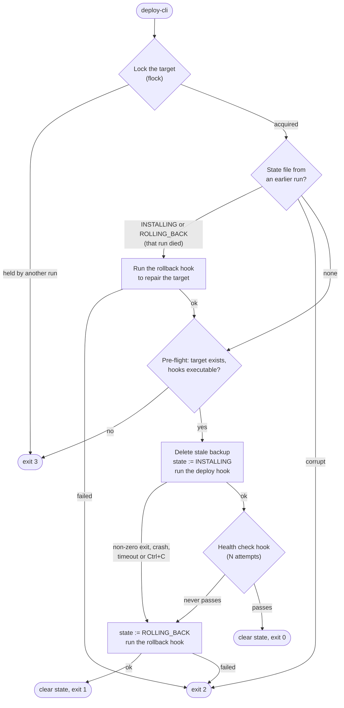

# DeployGuard (deploy-rollback-cli)

[](https://github.com/mitchee30/deploy-rollback-cli/actions/workflows/ci.yml)


`deploy-cli` is a small C++17 command-line tool that runs a deployment script
against a target directory and **automatically runs a rollback script if the
deployment fails** - whether the script exits non-zero, crashes, hangs, is
interrupted with Ctrl+C, or deploys something that then fails its health
check. If `deploy-cli` itself dies halfway (`kill -9`, power loss), the next
run notices and rolls the half-finished deployment back first.

It is meant to sit in a CI/CD pipeline or a release script on a single Linux
or macOS host, and reports what happened through its exit code.

## Try it

```bash
scripts/build.sh     # CMake build of deploy-cli and its tests
scripts/demo.sh      # install v1.0, deploy v1.1 (works), deploy v2.0 (broken)
```

The demo deploys a healthy release and then a broken one (it starts, but its
health check reports a database schema mismatch). Abridged output:

```text
==== 2/3  Deploy v1.1 (a healthy release) ====
[INFO]    Running deploy hook: ./scripts/deploy.sh ./test_app_target
[deploy.sh] backup committed: .../.deploy_guard_test_app_target.backup
[deploy.sh] v1.1 is running
[SUCCESS] Health check passed (attempt 1/3).
[SUCCESS] Deployment committed.
-> deploy-cli exit code: 0

==== 3/3  Deploy v2.0 (starts, but fails its health check) ====
[deploy.sh] v2.0 is running
[app v2.0] FATAL ERROR: Database schema mismatch! (column 'avatar_url' is missing in table 'users')
[WARN]    Health check failed (attempt 1/3); retrying in 1s.
...
[ERROR]   Health check failed after 3 attempt(s).
[WARN]    Rolling back: the health check failed.
[rollback.sh] rollback complete: version 1.1 is running and healthy
[SUCCESS] Rollback succeeded; the target is back in its previous state.
-> deploy-cli exit code: 1
```

## How it works



`deploy-cli` owns the *control flow*; the hooks own the *work*. It never
copies files itself - it decides when the deploy, health check and rollback
hooks run, makes sure they cannot hang forever or run twice at once, and
records just enough state on disk to finish an interrupted job.

### Exit codes

| Code | Meaning | The target is... |
| ---- | ------- | ---------------- |
| `0`  | Deployed (and passed the health check, if configured). | on the new version |
| `1`  | The deployment failed, timed out, was cancelled, or failed its health check - and the rollback succeeded. | back on the previous version |
| `2`  | The rollback failed (or a corrupt state file was found). The state file is kept, so the next run retries the rollback. | **in an unknown state: needs a human** |
| `3`  | Nothing was attempted: bad arguments or configuration, a failed pre-flight check (missing target, missing or non-executable hook), or another `deploy-cli` is already working on this target. | unchanged |

## Usage

```text
deploy-cli --config <deploy.yaml> [options]
deploy-cli --path <target_dir> [options]      # uses the bundled ./scripts/ hooks

  -c, --config <file>      YAML configuration (see below)
  -p, --path <dir>         Target directory, with ./scripts/{deploy,rollback,health_check}.sh
  -t, --timeout <seconds>  Time limit for each hook run; overrides the config (0 = none)
      --log-file <file>    Append a timestamped log here (default deploy_guard.log, "" = off)
  -n, --dry-run            Check everything and print the plan; run no hook, change nothing
  -h, --help               Show help
  -V, --version            Show the version
```

### Configuration (`deploy.yaml`)

```yaml
deployment:
  target_path: "./test_app_target"             # required
  scripts:
    deploy: "./scripts/deploy.sh"              # required
    rollback: "./scripts/rollback.sh"          # required
    health_check: "./scripts/health_check.sh"  # optional
  timeout_seconds: 600                # per hook run, 0 = no limit       (default 600)
  health_check_attempts: 3            # attempts before rolling back     (default 3)
  health_check_interval_seconds: 2    # pause between failed attempts    (default 2)
```

Relative paths are resolved against the directory `deploy-cli` is started
from. Unknown keys are reported as warnings, since they are usually typos.

### Writing hooks

A hook is any executable (shell script or binary). Each run gets:

| | |
| --- | --- |
| `$1` | the target path, exactly as configured |
| `DEPLOYGUARD_PHASE` | `deploy`, `health_check` or `rollback` |
| `DEPLOYGUARD_TARGET` | absolute path of the target |
| `DEPLOYGUARD_BACKUP_DIR` | where to keep a backup for the rollback hook (a hidden sibling of the target). `deploy-cli` deletes it before each new deployment, so a backup that exists during recovery always belongs to the interrupted deployment. |
| `DEPLOYGUARD_ATTEMPT` | health check attempt number (1, 2, ...) |
| stdin | `/dev/null` - hooks run non-interactively |
| process group | its own; on timeout or cancellation the whole group gets SIGTERM, then SIGKILL after 5 s |

Exit 0 means success. A rollback hook must work **no matter how far the
deploy hook got**, and must be safe to run **more than once** (it is re-run
if `deploy-cli` dies during the rollback). The bundled
[`scripts/deploy.sh`](scripts/deploy.sh) and
[`scripts/rollback.sh`](scripts/rollback.sh) show one way to do that: the
deploy hook never touches the target before a complete backup has been
committed with an atomic rename, so "backup exists" and "target modified"
always go together.

## Guarantees and how they are tested

| If... | then deploy-cli... | Tested by |
| --- | --- | --- |
| the deploy hook exits non-zero or crashes | runs the rollback hook, exit 1 | unit + `integration.cli_contract` |
| the deploy hook hangs | stops its whole process group after `timeout_seconds` (SIGTERM, then SIGKILL) and rolls back | unit + `integration.timeout` |
| the new version fails its health check | retries, then rolls back | unit + `integration.demo_end_to_end` |
| you press Ctrl+C or send SIGTERM | stops the hook and its children, rolls back (the rollback itself is not interruptible) | unit + `integration.cancellation` |
| deploy-cli is `kill -9`ed mid-deployment or mid-rollback | the next run finds the state file and finishes the rollback first | `integration.crash_recovery` |
| a second deploy-cli starts on the same target | refuses with exit 3 instead of "recovering" the live run | unit + `integration.concurrent_runs` |
| the rollback hook is missing or not executable | notices before deploying anything, exit 3 | unit + `integration.cli_contract` |
| the target path contains `'; rm -rf / #` or similar | passes it to the hook as one literal argument (no shell is involved) | unit |
| the state file is corrupt | refuses to guess, exit 2 | unit + `integration.crash_recovery` |

The design decisions behind these are written up in
[docs/DESIGN.md](docs/DESIGN.md).

## Building and testing

Requirements: a C++17 compiler (GCC, Clang) and CMake 3.16+, on Linux or
macOS. yaml-cpp and doctest are downloaded by CMake.

```bash
scripts/build.sh                      # or: cmake -S . -B build && cmake --build build
cd build
ctest --output-on-failure -j 8        # everything (~30 s)
ctest -L unit                         # 134 unit tests (doctest)
ctest -L integration                  # 6 suites driving the real binary
```

Line coverage of `src/` is about 89% (gcov). Most of the rest is error
handling for failing system calls (e.g. `fsync()` failing) and the code that
runs in the forked child between `fork()` and `exec()`, which gcov cannot
record.

Sanitizer build: `scripts/build.sh -DDEPLOYGUARD_SANITIZE=ON`
(AddressSanitizer + UndefinedBehaviorSanitizer). CI runs GCC and Clang on
Linux, Clang on macOS, a sanitizer build, a coverage build, shellcheck on
every script, and the demo, all with warnings treated as errors.

## Project layout

```text
include/deployguard/       one header per component
  deploy_controller.h        the state machine: lock -> recover -> pre-flight -> deploy -> verify -> commit
  process_manager.h          fork/execvp, output streaming, timeouts, process groups
  state_store.h              crash-recovery state file (atomic, fsync'd)
  file_lock.h                flock(): one deployment per target at a time
  signals.h                  SIGINT/SIGTERM/SIGHUP -> graceful cancellation
  config.h                   deploy.yaml parsing and validation
  argument_parser.h          command-line options
  logger.h                   console output and timestamped log file
src/                       implementations, main.cpp
tests/                     unit tests (test_*.cpp) and integration/ (bash)
scripts/                   demo hooks, setup_v1.sh, demo.sh, build.sh
releases/                  the demo app: v1.0, v1.1 (healthy), v2.0 (broken)
docs/DESIGN.md             design notes
```

## Limitations

* One host. `deploy-cli` coordinates runs on the machine it runs on; it is
  not a distributed deployment system.
* The lock uses `flock()`, which is not reliable on some network file
  systems (e.g. NFS). Keep targets on local disks.
* Linux and macOS only (POSIX process and file APIs).
* `deploy-cli` can only be as safe as the rollback hook: it guarantees the
  hook *runs* when it should, not that it restores everything correctly.

## License

MIT - see [LICENSE](LICENSE).
